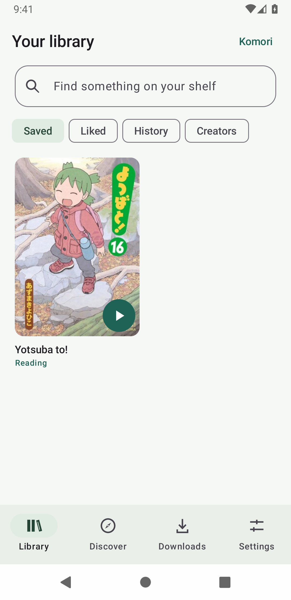
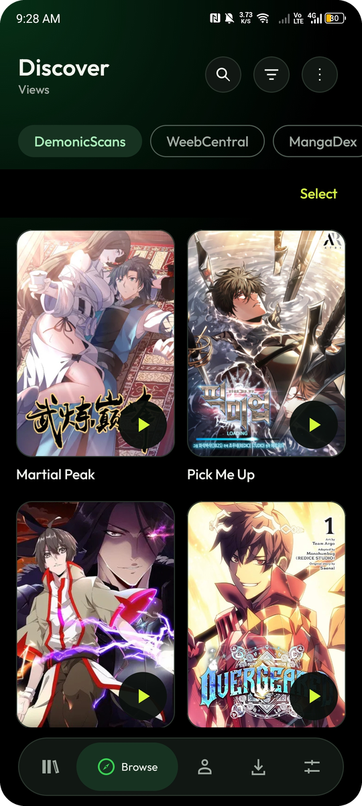
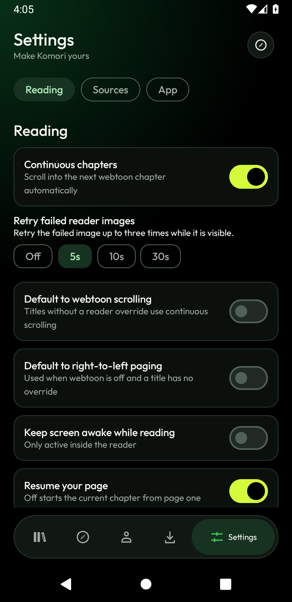

<div align="center">


# Komori

**A quiet, lightweight Android manga reader.**
Built with Kotlin and Compose. Native online and offline reading.

<br>

[](https://github.com/joy-arz/komori-reader/releases/latest)
[](#install)
[](#build)
[](#features)

<br>

[Download](#install) · [Features](#features) · [Sources](#sources) · [Build](#build) · [Limits](#current-limits) · [Docs](#documentation) · [Contributors](#contributors)

<br>

&nbsp;&nbsp;
&nbsp;&nbsp;


</div>

<br>

> **Current release: 0.7.1.** Signed APK for Android 8.0 and newer. This is a full GitHub release. Source-specific limitations and planned features are listed below.

---

##  At a glance

| | |
|---|---|
| &nbsp; **Design** | Black and lime, Outfit typography, floating navigation |
| &nbsp; **Reading** | Paged and Webtoon modes, zoom, immersive controls |
| &nbsp; **Offline** | Persistent downloads with integrity checks and repair |
| &nbsp; **Discover** | Six sources, tag, author, parody, language and category browsing |
| &nbsp; **Updates** | Verified in-app updates from GitHub releases |
| &nbsp; **Private** | No account, no ads, no analytics. Everything stays on your device |

---

##  Features

###  Design and interface

- Black-and-lime design with Outfit typography, outlined collection, setting and chapter cards, green gradient actions and floating navigation.
- Dark appearance is the default. An explicitly saved light preference is retained.
- Settings are grouped into **Reading**, **Sources** and **App**.
- Background update checks and downloads use a nonblocking banner. Installation dialogs open from **Review/Install**.
- Compact Library and Discover toolbars with icon-triggered search. Library collection tabs keep counts in a shorter row, leaving more room for covers.
- Swipe left or right across the catalog to change sources in your Settings order.
- Discover filters live in the toolbar. **Verify source** and **Reset search** sit under Source options.

###  Reading

- Direct reading from cover play buttons, page resume, a restart-current-chapter preference and optional rereading when caught up.
- Per-title **Left-to-right**, **Right-to-left** and **Webtoon** modes, with app-default fallback.
- Continuous webtoon scrolling across chapters, with saved page and scroll position, bounded neighboring-chapter windows and image strips. Works offline, with a Paged/Webtoon switch.
- Immersive reading. A center or image tap hides controls, and a floating page counter brings them back.
- Direction-aware edge taps and swipes in paged mode.
- Tiled pinch and double-tap zoom, plus optional keep-screen-awake.
- Dismissible **Continue reading** banner (restore it in Settings) and direct **Read offline** from Downloads.

###  Library and organization

- Personal library, likes, reading statuses and history stored locally with Room.
- The **Downloaded** collection includes titles with saved pages and opens their offline chapter list.
- Long-press a title, chapter, download or followed creator to select it. Batch controls appear only during selection; browsing has no idle Select bar.
- Bulk actions: save, like, download, read-state changes, pause, resume, and confirmed deletion or unfollow. Select all applies to loaded or filtered items.
- Possible-duplicate warnings for normalized matching titles already saved from another source. Titles are never merged automatically.
- Dedicated **Authors** tab with compact creator chips, searchable follow management and complete paginated source catalogs.
- Saved titles keep their source order and receive no Library highlight.

###  Smart Chapters

- Language filtering and conservative duplicate grouping.
- Preferred scanlation with strict or fallback selection.
- Chapter lists show source-returned counts, unavailable entries and active filters.
- Choose **Language** on a title to check another translation or all languages.
- Start reading uses ascending chapter numbers, independent of the list's newest-first display option.
- Smart Chapters keeps the current scanlation where possible. Unread and downloaded filters only affect the visible list.

###  Downloads

- Persistent chapter downloads with Wi-Fi constraint, retries, pause and resume, original or data-saving images, and offline access.
- Bulk options: all readable, all unread and next 1, 5, 10 or 25 unread. Active and completed downloads are skipped.
- A compact Downloads header shows queued and offline counts. Queue options contain pause and resume/retry commands when available. Completed chapters omit redundant progress bars; active transfers retain detailed progress.
- Configurable visible-image retries (off, 3, 5, 10 or 30 seconds, up to three attempts, 3 seconds by default).
- Integrity checks when opening saved chapters, a persistent **Needs repair** status and targeted repair. Intact pages stay accessible with **Read saved pages**.

###  Discover and browsing

- Source results load the next page automatically near the end. Failures keep a manual retry, and repeated pages stop automatic loading.
- Exact **Tag**, **Author**, **Parody**, **Language** and **Category** name browsing, alongside title search.
- Language and category are separate browse filters. Nhentai can combine them with tags, parodies and creators.
- HentaiZap and ImHentai offer those filter combinations in title browsing, with explicit limits in metadata browsing.
- Gallery details group tappable tags, parodies, languages and categories, alongside authors and artists.
- Source-native popularity sorting:
  - **HentaiZap:** Popular, Top Rated, Downloaded
  - **Nhentai:** daily, weekly, monthly and all-time popularity
  - These are source rankings, not locally calculated view counts.
- HentaiZap metadata extraction excludes unrelated sidebar and ranking tags and strips entity counts from names. Existing saved tags remain compatible, so no database reset is needed.

###  Source verification and network

- The user-operated **Verify source** screen shares source cookies and user agent with native requests and cover loading.
- HTTP 403 stays distinct from a detected verification challenge. Blocked downloads wait for user action instead of retrying repeatedly.
- Cookies are isolated from unrelated image hosts and excluded from app backup.
- Nhentai catalog and reader-manifest GETs retry reset and EOF failures once through a separate HTTP/1.1 connection pool. The browser session and TLS checks stay in place.
- Persistent transport failures explain the network limitation. Verify source handles browser challenges, not connection resets.

###  App updates

- GitHub release checks on launch and foreground, with a 30-second foreground debounce.
- Automatic APK download on unmetered networks, plus manual checking and downloading.
- Verified same-key upgrades through Android's installer.

---

##  Sources

Reorderable source tabs in this order: DemonicScans, WeebCentral, MangaDex, HentaiZap, ImHentai and Nhentai.

| Source | Status | Highlights |
|---|---|---|
| **DemonicScans** | Native | Reading and downloads. Views, new and title browsing, genre selection. Title search is separate from genre browsing. |
| **WeebCentral** | Experimental | Native paged and webtoon reader. Parser and request routing have fixture coverage. |
| **MangaDex** | Native | Search, popularity, rating, update and title sorting, tag filters, safe and suggestive catalog filtering. |
| **HentaiZap** | Native | Popular, Top Rated and Downloaded sorting. Tag, parody, language and category filters. |
| **ImHentai** | Native | Tag, parody, language and category filter combinations in title browsing. |
| **Nhentai** | Native | Daily, weekly, monthly and all-time popularity. Filters combine with tags, parodies and creators. |

> **Comix is removed.** Existing source preferences are filtered automatically.

MangaDex must be reachable on your network. If a network redirects or blocks it, the app reports a connection error and keeps certificate verification enabled.

MangaDex and scanlation groups are credited in the application. This is an independent client, not an official MangaDex app. Source availability and policy can change.

---

##  Install

<div align="center">

### [Download komori-0.7.1.apk](https://github.com/joy-arz/komori-reader/releases/download/v0.7.1/komori-0.7.1.apk)

</div>

Or open [GitHub Releases](https://github.com/joy-arz/komori-reader/releases) and expand **Assets**. Choose the `.apk` file, not the source-code archives.

Full releases and earlier alpha builds use the same private release key. Install over your existing app to keep your Library, downloads and reading progress.

---

##  Build

**Requirements**

- JDK 17 (JDK 21 also works locally)
- Android SDK platform 36 and build-tools 35.0.0
- `ANDROID_HOME` set, or an untracked `local.properties` containing `sdk.dir=/absolute/path/to/sdk`

```sh
./gradlew testDebugUnitTest lintDebug assembleDebug
```

The APK is written to `app/build/outputs/apk/debug/app-debug.apk`.

Release builds use R8 and resource shrinking. An unsigned local release can be built with `./gradlew assembleRelease`. Signed releases require the environment variables documented in [release setup](docs/RELEASING.md).

Local signing is automated through JVM `keytool` validation and Gradle. See [releasing instructions](docs/RELEASING.md).

---

##  Automated releases

Every push to `main` and every pull request runs unit tests, lint and a debug APK build.

A version tag such as `v0.7.1` automatically tests, builds, signs and publishes a release APK plus a SHA-256 checksum and updater metadata (`update.json`).

- Plain version tags publish full releases and mark them as **Latest**.
- Tags containing a suffix remain prereleases.

```sh
git tag v0.7.1
git push origin v0.7.1
```

Signing secrets are already configured in repository Actions secrets. No signing material is committed. See [RELEASING.md](docs/RELEASING.md) for key backup and release details.

---

##  How app updates work

Install version 0.5 manually once if you are coming from an older build. After that, each launch checks public GitHub releases, including full releases and prereleases.

- Failed update checks do not block reading.
- Automatic downloads default to unmetered connections. Change this in Settings, or choose a manual download on mobile data.
- Android requires permission to install from Komori and confirmation in its installer. This is not a silent system installation.
- The updater verifies the checksum, package, increasing version code and existing signing certificate before installation.
- No GitHub token is stored in the app.

---

##  Current limits

<details>
<summary><b>Reader</b></summary>

<br>

- Webtoon mode saves the vertical position within each source page. Paged mode saves the page, not its zoom and pan viewport.
- Continuous chapters can be disabled in Settings. Webtoon pinch zoom and automatic mode detection remain planned.

</details>

<details>
<summary><b>Library and sync</b></summary>

<br>

- Creator follows are local. Automatic creator and title update feeds and MangaDex account sync are not implemented.
- Collection management, backup and restore, storage-management UI and per-title language overrides are planned.

</details>

<details>
<summary><b>Chapters and downloads</b></summary>

<br>

- Smart Chapters uses deterministic selection, not translation-quality scoring. Unnumbered releases and different volumes stay separate. Volume metadata inconsistencies may leave duplicates visible.
- Download work is interruptible and Android may delay it. There is no promise of uninterrupted large background transfers. Work checkpoints each page and retries.

</details>

<details>
<summary><b>Performance</b></summary>

<br>

- Low-end performance budgets are goals. They are not yet verified on a physical 2 GB device.

</details>

<details>
<summary><b>Source limitations</b></summary>

<br>

- MangaDex external-only chapters cannot supply pages to the native reader. Start reading skips those entries and chooses the first readable chapter. Their separately labeled external links remain available.
- DemonicScans and WeebCentral pages use the native paged and webtoon reader and the same download storage, not embedded website readers.
- Completed downloads can be opened directly without a source refresh. MangaDex IDs and existing library and download data are retained.
- Source websites may block requests or change their HTML. WeebCentral's parser and request routing have fixture coverage, but live reading has not been verified on the current network.
- For HTTP 403 or a browser-verification prompt, use **Verify source**, complete verification manually, then **Retry native access**.
- Download jobs waiting for verification retain completed pages. Resume them from Downloads after verification.
- **Reset sessions** clears all source browser cookies and storage without changing library data.
- Browser verification cannot guarantee that a source will accept native requests. Unsupported sources are not represented as working readers.

</details>

---

##  Documentation

| Document | Description |
|---|---|
| [Source and session review](docs/SOURCE_SESSION_REVIEW_2026-10-15.md) | Follow-up review of sources and sessions |
| [Implementation plan](docs/PLAN.md) | Roadmap and design decisions |
| [Validation notes](docs/VALIDATION.md) | Test and verification results |
| [Komikku reference review](docs/KOMIKKU_REVIEW.md) | Feature comparison, implemented reader improvements and remaining priorities |
| [Releasing](docs/RELEASING.md) | Signing, key backup and release steps |
| [TODO](docs/TODO.md) | Complete prioritized backlog |

---

##  Contributors

<a href="https://github.com/joy-arz/komori-reader/graphs/contributors">
  
</a>

Maintained by [@joy-arz](https://github.com/joy-arz). Issues and pull requests are welcome.

---

##  Credits

- **Typography:** Outfit is bundled under the SIL Open Font License. See `app/src/main/assets/licenses/Outfit-OFL.txt`.
- **Icon:** Supplied bat-and-manga artwork, cropped to remove the outer surround. Android applies the launcher shape through an adaptive icon, and the original illustration is preserved.
- **Icons:** [Lucide](https://lucide.dev) via [Iconify](https://iconify.design), ISC license.
- **Sources:** MangaDex and scanlation groups are credited in the application.

<div align="center">

<br>

*Read quietly.*

</div>
