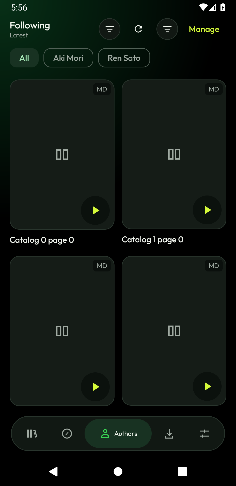
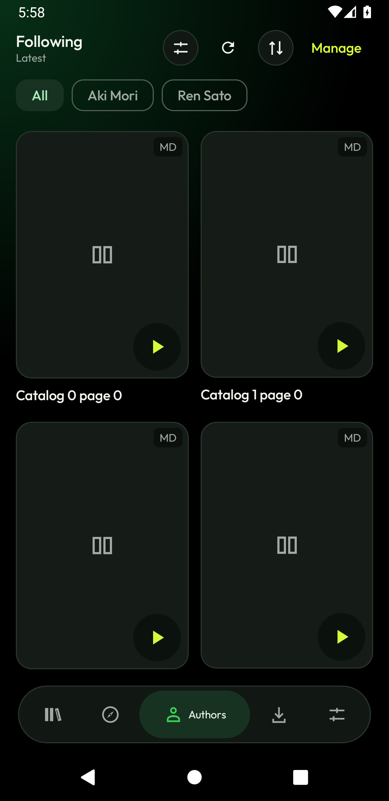

# Reliability and UI follow-up

Updated October 28, 2026. [PR #3](https://github.com/joy-arz/komori-reader/pull/3), branch `codex/reliability-ui-followup`. No merge, tag or release is part of this task.

## Audited revision and delivery

Fetched main on October 27 and again October 28: **501ea97f3cd060395cf4ab8a495adfc7d5d3774a**, exactly the supplied audit revision. No intervening merged app changes existed. The initial working tree was clean; no applicable repository/ancestor AGENTS.md was found. Supplied historical test results were treated as starting evidence and rerun.

Application implementation validated by the final green cloud matrix: **ebceecbde46b6ef7afd2ca2087143a3a6457faea**. Subsequent changes add a debug-only startup-recovery barrier, instrumented-test synchronization, and this report/evidence; the release-preparation keyboard fix below is the additional application change; package identity, version and signing configuration remain unchanged. The barrier passed three local SIGKILL/restart probes, and current-head checks are available on the PR.

Package identity, version, production signing configuration/secrets, TLS validation and APK verification remain unchanged. All commits use the existing repository-owner identity without coauthor attribution. No unrelated changes were discarded. PR release compilation is unsigned and includes shrinking.

| Priority | Classification | Final implementation and evidence | Remaining acceptance |
|---|---|---|---|
| 1 Authors controls | Confirmed UX ambiguity: filter and sort shared the same glyph | One primary Tune filter, distinct sorting, active/reset semantics, preserved search/manage/batch actions; before/after images and UI tests | Manual TalkBack/focus/contrast |
| 2 Updates | Confirmed check/download ownership race | Explicit phases/jobs/generation/artifact ownership; delayed owner and dialog tests | Signed-release installation on a phone |
| 3 Migration | Confirmed obsolete search/detail publication and stale Apply context | Cancel/invalidate requests; immutable reviewed rows; transactional Apply guards and actual Room race test | No additional code deferral |
| 4 Author catalogs | Confirmed individual details failure poisoned page/cursor, including supplemental source path | Bounded isolation, pending metadata/ownership, targeted retry and fair later paging; real HentaiZap adapter fixtures | Live-source acceptance |
| 5 Temporary files | Confirmed updater/export process-death ownership gap | Scoped cleanup, active callback protection, ready APK/unrelated retention; ownership and SIGKILL tests | No additional code deferral |
| 6 API 36 selection | Confirmed stale native action role/label despite correct rendering | Explicit accessible action plus mode-specific identities for rows and Manage/Done; complete 5/5 API 36 repeat pass | Manual TalkBack |
| 7 Downloads | Confirmed reader-file and finishing-worker retry gaps; reproduced upstream service race | Reader leases, retry ownership, checksum repair/reuse, WorkManager 2.10.5 patch; real scheduler/lifecycle probes | Physical manufacturer battery/Doze behavior |
| 8 Page identity | Risk demonstrated by parsed Nhentai delivery-host rotation fixture | Strict source-specific identity; signed/unknown URLs retained exactly; quality/content invalidation tests | Live CDN rotation unobserved |
| 9 Diagnostics | Improvement requiring implementation | Safe source/stage/kind/action messages, redaction and typed retry/verification preservation | Live failure/verification acceptance |
| 10 Performance/accessibility | Measurement and acceptance work | 1,000-title/50,000-progress, startup/session/cache measurements; narrow/150%/RTL/landscape tests | Physical 2 GB, release-frame benchmarks and manual accessibility |
| Prior repairs | Already present | Reader cache pinning, interrupted import recovery, planned continuation, speculative retry accounting and exact-revision release gates retained | Existing regressions pass |

- [x] Reproduce or demonstrate each defect; distinguish risks and external acceptance.
- [x] Implement focused fixes and meaningful regressions; preserve existing features/security.
- [x] JVM, Python, lint, debug and release compilation.
- [x] Five complete targeted API 36 repetitions, then full API 26/30/36 coverage.
- [x] Capture Authors before/after, native stale-state evidence, recovery logs and measurements.
- [x] Commit/push the focused PR and investigate introduced failures.
- [ ] Physical-device and live-service acceptance listed below; unavailable in this environment.

## Defects, intended behavior and regression evidence

### 1. Authors filter entry point

**Trigger/root cause:** Normal Authors browsing exposed metadata/Library filtering and sorting with the same FilterList glyph. The shared screen toolbar did not add another Authors filter; these were different controls, not duplicate filter implementations. **Impact:** users could not distinguish filtering from sorting.

**Change:** one primary action is labeled `Filter author works`, uses Tune, has a selected/state-description indicator, a minimum 48 dp target, and visible Reset filters. Sorting remains separately labeled `Sort author works` with an up/down icon and all four orders. Manage retains followed-author search, unfollow and batch actions. No Discover filter was removed. Filter state remains Authors-specific and survives expected tab navigation; management/search changes clear selection. Dialog actions wrap at large font sizes.

**Coverage:** AuthorsFilterActionTest checks exactly one clickable semantic primary filter in normal and searched/filter-applied states, zero in management, preserved sorting/navigation/reset, 320 dp width, 150% font and RTL. AuthorFilterAccessibilityTest covers landscape/150%/RTL action visibility and field usability. AuthorsInteractionTest exercises saved/followed works. Manual TalkBack focus/announcement/contrast acceptance remains pending.

| Before: ambiguous identical glyphs | After: distinct filter and sort |
|---|---|
|  |  |

Both screenshots use the same synthetic AuthorsInteraction fixture. The baseline APK was re-signed only with the local disposable **debug** keystore to compare debug installs; production signing was untouched.

### 2. Update operation ownership

**Trigger/root cause:** With cached release A exposed, check B could start, download A could start concurrently, then check B replaced the whole state. **Impact:** lost download progress, duplicate transfers, or A's APK shown against B's metadata. **Intended behavior:** one compatible operation owns callbacks and results at a time.

**Change:** UpdateOperations owns jobs, generations, artifact identity and phases `IDLE`, `CHECKING`, `AVAILABLE`, `DOWNLOADING`, `READY`, `FAILED`. Dismissal/snoozing controls visibility independently of phase. Both check and download enforce mutual exclusion. Check cancellation restores cached available/ready state. Channel changes cancel/invalidate a check; a transfer retains its channel. Every progress/success/failure callback checks its generation and exact artifact. A newly discovered artifact clears an old ready file. Same-artifact release-note changes do not invalidate a ready APK. Controls mirror those transitions.

Automatic unmetered downloading, manual downloading, cooldowns, snoozing and Android confirmation remain. Production download still checks expected size, SHA-256, package, version and signing certificate. Debug production downloads remain disabled; only an injected fake backend enables the dialog test and it cannot reach installation.

**Coverage:** eight UpdateOperations tests, automatic download matrix, delayed checks/cached downloads/out-of-order completion/channel changes/cancellation/failures; UpdateUiCoordinationTest exercises the cached dialog disabled while checking and the exact new artifact on completion.

### 3. Migration request and Apply context

**Trigger/root cause:** Editing query/source reset visible state without invalidating active work; searches published captured state and selected destination details shared mutable rows. **Impact:** obsolete results/chapters could overwrite new context or be reviewed/applied under another destination.

**Change:** every edit, search, selection, close and teardown cancels old work and advances generation. Noncooperative late success/error is ignored. Destination details must match the selected title and source. The reviewed destination owns immutable chapter rows, language, original/target and generation. Apply checks that snapshot before and inside the existing Room transaction; cancellation rolls back. Obsolete mapping rows clear immediately. Existing chapter ownership, language, completed progress and optional page-copy safeguards remain.

**Coverage:** delayed query/source edits, out-of-order requests, obsolete errors, delayed selection details, close/reopen; MigrationApplyRaceTest uses the actual Room database to transfer completed progress only to the latest valid destination.

### 4. Author metadata and fair paging

**Trigger/root cause:** Catalog enrichment used awaitAll without isolating individual details errors. HentaiZap supplemental creator lookup and source-level language enrichment could fail even before AuthorCatalog received the page. **Impact:** one persistent 404 hid valid titles and prevented cursor advancement, repeatedly blocking later pages.

**Change:** title enrichment runs in bounded chunks of two, preserves coroutine cancellation, and records incomplete metadata per title. A successful catalog page advances independently of title details; catalog-page failures remain separate failures. Unknown language/category/tags never count as a filter match. Explicit retry requests only pending titles; successful items deduplicate and persistent failures do not automatically retry on each page.

Authors opts into deferred HentaiZap supplemental creator details. Native creator-page entries retain known ownership; supplemental candidates with failed/empty ownership remain pending until details prove the expected creator ID. Name-only search hits and known different creators are excluded. Deferred failures are bounded (256 entries, ten-minute window); explicit retry bypasses deferral and refresh clears it. Native source language filtering is used only where supported without hidden bulk enrichment (MangaDex/Nhentai); Authors' isolated metadata owner handles the other sources. Other Discover callers retain their behavior. Fair round-robin creator paging, rank/sort and duplicate ownership are retained.

**Coverage:** AuthorMetadataTest covers valid plus persistent 404, no matching results, catalog failures, later pages, targeted transient recovery, duplicates, other creators and cancellation. SourceAuthorIsolationTest uses real WebSource parsing plus AuthorCatalog against MockWebServer, including supplemental 404, later pages, retry, empty/name-only/unrelated ownership. No live HentaiZap result is claimed.

### 5. Updater and export file recovery

**Trigger/root cause:** finally cleanup cannot run after process death; updater parts and temporary comic exports had no startup owner recovery. **Impact:** repeated interruptions grew cache usage.

**Change:** OwnedTemporaryFiles reference counts active asynchronous writers; cleanup cannot delete their files and callbacks starting after ownership ends cannot recreate them. Updater downloads serialize across instances. Startup cleanup matches only updater-owned part patterns and exporter-owned comic CBZ patterns, including old cache-root exports; new exports use a dedicated directory. Ready APKs and unrelated files remain. Recovery failures cannot block startup.

**Coverage:** four ownership tests cover existing orphans, active protection, repeated cleanup, unrelated files, late callbacks and interrupted writing. Emulator SIGKILL startup probe removes reader/import/updater/export orphans and preserves cached images, persistent markers, ready-named APK and unrelated part. The retained APK is a filename/retention fixture, not a fake verifier pass.

### 6. API 36 author selection and navigation

**Reproduction:** unchanged main initially passed five targeted repeats in [40489579309](https://github.com/joy-arz/komori-reader/actions/runs/40489579309). Later repeated runs captured two visually rendered checkboxes while native accessibility still exported the second row as a `Manage author` Button with old bounds. Selection had activated and both rows were on screen. [Failure screenshot](screenshots/authors-stale-semantics-api36.png), [hierarchy excerpt](screenshots/authors-stale-semantics-api36.json). Immutable captures, a custom row and clearAndSetSemantics alone each proved insufficient in subsequent repeats; short successful runs were not treated as closure.

**Change/root cause:** the browse-to-selection transition changed an existing action's native role, name and geometry while the accessibility tree could retain its old identity. AuthorManagementRow now owns the name, click/long-click, role and checked semantics on one actual action, and keys the subtree by mode so a Button becomes a fresh CheckBox action. The checkbox visual is decorative; normal Unfollow remains a separate action. A later extended test exposed the same stale-label problem on the Manage/Done control, which now also has a mode-specific identity. Styling, list ownership and ordinary pointer actions remain.

**Coverage:** native action/long-click and checked-state assertions, two-author selection, dismissal, ordinary author navigation, re-entry, query changes clearing selection, unfollow, and the original Library/Downloads cancel/confirm actions all remain. Compose waits/gestures synchronize actual state; original timeout bounds were retained. No sleeps, removed assertions or test-side accessibility cache clearing hide the defect. Author catalog transport is injected locally for this UI test; synthetic creator IDs no longer contact MangaDex. The latest five complete repetitions passed in [40568312683](https://github.com/joy-arz/komori-reader/actions/runs/40568312683). [Verified native state](evidence/authors-selection-api36.json), [local selected-state screenshot](screenshots/authors-selection-api30.png).

### 7. Downloads and concurrent file use

**Confirmed causes:** delete/manifest replacement could remove files owned by an active reader; an explicit retry could race a failed worker still finishing while KEEP retained the old work. API 30 also reproduced a foreground-service shutdown/pending-command crash in WorkManager 2.10.1.

**Change:** chapter reader leases prevent deletion or incompatible manifest replacement while displayed. Explicit retry cancels/replaces old work under queue/chapter ownership. Committed pages are reused only with matching content identity and valid image/SHA-256; corrupted pages are refetched individually. Interrupted per-page parts are reclaimed under the chapter lock. Stopped/cancelled callbacks cannot publish transfer progress. Existing serial writer gate, planned continuation, backoff and retry timing remain. WorkManager/testing upgrade only to 2.10.5, whose [official patch notes](https://developer.android.com/jetpack/androidx/releases/work#2.10.5) include the reproduced pending-command shutdown fix and intervening network constraint fixes. Downloading rows without an active transfer say Waiting for Android, after specific storage/network/Wi-Fi waits.

**Real scheduler coverage:** WorkManagerLifecycleTest creates actual OS-scheduled workers with bounded loopback HTTP fixtures: slow/pause, delete/no resurrection/queue continuation, persistent failure and retry, valid-image SHA corruption and repair, low-storage boundary, connection reset/backoff/recovery, reorder and finishing-worker retry. It checks committed usable pages, first-page reuse and reader deletion protection. The debug fixture provider requires DUMP, permits only fixture IDs and HTTP 127.0.0.1, and is absent from release.

Host probes use root SIGKILL (never force-stop for download recovery), persisted fixture configuration, real foreground work and app relaunch. Local API 30 passed OS network loss/recovery, ongoing foreground transfer with display asleep, process restart, queued continuation and preserved pause intent. An earlier combined network-return-while-asleep API 36 probe remained ENQUEUED with connectivity restored after 45 seconds; Android scheduling latency is not a guaranteed immediate-resume deadline. Network recovery and ongoing screen-off transfer are now separately tested. Manufacturer Doze/battery restrictions and unattended physical-device behavior remain pending.

### 8. Source-specific identity

**Demonstration:** the Nhentai parser fixture returns stable numeric gallery/media/page paths while the image host changes. Full-URL identity needlessly invalidates unchanged content. This is fixture evidence, not observed live rotation.

**Change:** recognized query-free HTTPS Nhentai image hosts use numeric media/page/path identity. MangaDex preserves hash, filename and data/data-saver quality. Other sources, unfamiliar hosts, query parameters and signed URLs remain exact. Changed content, ordering, page count, format or quality invalidates reuse.

**Risk:** old hash-only MangaDex manifests did not preserve quality. Their partial downloads conservatively refresh once on resume/repair because compatibility cannot be proved. Completed downloads are not erased during startup. Four identity tests distinguish unchanged delivery rotation from real content/quality/order/count changes and preserve unknown/signed URL identity.

### 9. Source diagnostics

SourceRequestFailure associates source and stage with catalog/search, details, chapter list, filter/language discovery, page manifest and image transfer. It distinguishes verification, HTTP/rate limiting, transport/offline and parsing/unsupported content, with concise actions. Numeric HTTP status remains visible for worker regressions. Optional diagnostic text excludes URL/query, credentials, cookies, authorization, tokens and server bodies. No history export was introduced. TLS validation, source verification, cancellation, rate cooldowns and bounded retry policy remain; parsing failures are not hidden behind endless transport retries.

## Verification results

All three cloud checks passed on ebceecb:

| Check | Exact result | Evidence |
|---|---|---|
| JVM | **200 discovered: 194 passed, six optional live-network tests skipped; zero failures** | [Android checks 40568312677](https://github.com/joy-arz/komori-reader/actions/runs/40568312677) |
| Lint/build | **Zero lint errors, original 46 warnings; debug and release shrinking compiled** | Same Android checks run; no signing secrets or release publication |
| API 36 targeted | **5/5 complete repeated BatchSelection tests passed** | [40568312683](https://github.com/joy-arz/komori-reader/actions/runs/40568312683) |
| API 26 / 30 / 36 | **80/80 instrumented tests passed on each API** | [Device checks 40568312690](https://github.com/joy-arz/komori-reader/actions/runs/40568312690) |
| Startup process recovery | **Three consecutive SIGKILL/restart cleanup probes passed on each API** | Same device run; fails on first unsuccessful attempt |
| Real download recovery | **OS network loss/recovery, ongoing screen-off transfer, SIGKILL/restart, queue continuation, committed-page reuse and preserved pause intent passed on each API** | Same device run; synthetic HTTP and real WorkManager |
| Python | **10 tests passed**; host scripts compile; shell syntax checks pass | Local unittest suite |

Local API 30 evidence also includes: 16/16 integration tests in 223.747 seconds; a later 11/11 UI/worker subset in 137.684 seconds; final focused Authors/filter/landscape/RTL tests **5/5 in 63.611 seconds**; and all six WorkManager plus three reading/background cases **9/9 in 10.254 seconds with Wi-Fi disabled**, restoring the preference afterward. These are emulator/fixture checks, not physical-phone acceptance.

The final debug-only `ready` barrier waits for startup recovery before orphan files are created, replacing a fixed three-second staging delay. With that barrier and ActivityManager acknowledgment, three additional local startup probes passed. [Barrier probe evidence](evidence/cache-recovery-barrier-api30.json). Earlier [download recovery](evidence/download-process-recovery-api30.json) and [cache recovery](evidence/cache-process-recovery-api30.json) raw records remain. A ready-named dummy APK in these retention tests was not passed off as verified installable content.

### Failures investigated rather than masked

- API 26's validated network was sometimes **metered cellular**. WorkManager correctly refused Wi-Fi-only fixture requests. Every real-work fixture now explicitly allows metered loopback traffic and restores the user preference; production constraints remain. This resolved five worker timeouts and the background-transfer timeout. [Native constraint and ActivityManager log excerpt](evidence/api26-fixture-coordination.txt).
- The startup probe previously relaunched as soon as the kernel PID vanished, before ActivityManager processed binder death. API 26 logged `DeadObjectException`, forced activity removal and a spurious old-process death during relaunch. The probe now waits for Home focus and old-PID removal from ActivityManager before restarting. It still uses SIGKILL, never force-stop, and retains the 30-second launch bound. An attempted SIGQUIT trace had a platform file-permission error; no app Java deadlock was demonstrated and no speculative SourceSessions threading change was made.
- NavigationHistory retained a UiObject2 across lazy-row recycling. It now captures immutable text/bounds together, discards stale nodes and retains the exact restored-pixel assertion.
- A background test invoked a direct worker while Activity startup could schedule another worker for the same fixture. It now injects transport into one real WorkManager worker. Offline-detail readiness waits for its actual asynchronous producer before checking native UI, rather than waiting on an unadvanced Compose test frame.
- Earlier host fixtures had API 26 content-call port syntax and HTTP path/query parsing errors; these were corrected without loosening production URL identity or network policy. A local incompatible emulator graphics snapshot produced a System UI ANR; cold boot corrected the environment. Such runs were not counted as passes.
- A local heavy lint/shrinker run overlapping the emulator was stopped and is not counted as success. Linux CI lint/release checks passed. Existing GitHub action deprecation notices remain outside this focused pass.

## Measured performance, not phone claims

API 30 local arm64 emulator, debug APK, shared 8 GB Mac host. Gradle was stopped during measurements. [Raw log](evidence/measurements-api30.txt), [cold launches](evidence/cold-start-api30.json), [gfxinfo](evidence/large-library-gfx-api30.txt).

| Workload | Observed result | Interpretation |
|---|---|---|
| 80 synthetic 256×4096 webtoon decode/cache iterations; 3,685,498 encoded bytes/page | Median 39.89 ms, p95 82.44 ms; retained 66,338,964 B under 67,108,864 B; PSS 161,589→165,804 KB | Real sampled decode/cache/eviction/pinning; not full-reader frame/recomposition acceptance |
| Source-session construction, warm process | 417.92 / 0.206 / 0.105 ms | First sample may include WebView/native initialization; no phone claim |
| Real Room 1,000 titles + 50,000 progress seed | 19,915.70 ms; first Activity visible 17,768 ms; PSS 95,259→170,514 KB | Includes debug JIT/first Activity/WebView; not a release cold-start claim |
| Large Library UI | Four accessible cover nodes; unselected VM observes no progress rows; 50 progress writes/observations 2,836.57 ms; composition apply delta 0 | Confirms lazy/scoped observation behavior; no speculative index/rewrite |
| Disk-backed progress query | Full-table median 415.73 ms vs title-scoped 2.31 ms, existing index_progress_mangaId | Verifies earlier scoped-query repair |
| Three process-cold debug launches, disk/OS caches retained | TotalTime 2,133 / 4,124 / 3,609 ms | Force-stop used only for this startup measurement |
| Software-emulator large-Library gfx | 125/125 janky frames, median 300 ms, saturated GPU histogram | Poor emulator frame results; cannot establish smoothness or physical low-memory performance |

No heavy dependency, expensive effect or broad database rewrite was added based on these numbers. Physical 2 GB memory pressure, full long-session release-frame profiling, manual TalkBack/focus/contrast and source-session startup on phones remain acceptance work.

## Remaining acceptance and known risks

- No physical phone is connected. Manufacturer battery restrictions/Doze, thermal and 2 GB memory pressure, manual TalkBack/focus/contrast, signed-release installation and full long-session release-frame profiling remain pending because emulator evidence cannot establish them.
- Six optional live-network tests were skipped. Real sources, challenge redirects/browser verification and delivery-host rotation have not been newly accepted against live services. Fixtures distinguish these from code-path verification.
- Incomplete author metadata deliberately excludes uncertain matches until a targeted retry succeeds. Persistent errors require user action, not automatic retry loops.
- Legacy hash-only MangaDex **partial** manifests may refresh once on resume/repair because image quality compatibility cannot be proved. Completed downloads are not erased during startup. Unproven provider identities retain full URLs, favoring correctness over speculative reuse.
- Android can defer constrained work after connectivity returns, particularly while asleep. An earlier combined API 36 network-return/sleep probe remained ENQUEUED after 45 seconds; separate network-recovery and ongoing screen-off transfers passed. No hard background resume deadline or manufacturer guarantee is claimed; Waiting for Android explains scheduler waits without resetting backoff.
- Software-emulator frame measurements were poor, as recorded above. No claim of phone smoothness or low-memory performance is made.

The PR is the review/delivery artifact. It must not merge automatically; no release, tag, signing identity or version change is included.

## 0.8.6 release-preparation follow-up

The notes-only preparation commit 08d4b24 passed Android checks and the API 30/36 device jobs. API 26 passed 79/80 instrumentation tests and every startup/download recovery probe, but AuthorFilterAccessibilityTest could not find Apply during initial landscape dialog detection (run 40623089334). The previous landscape test attached custom content to a manually launched Activity and immediately queried native accessibility, without an orientation/configuration or Compose-layout readiness barrier. It also lacked failure captures for that case.

Both filter accessibility cases now use an ActivityScenario-backed Compose rule, explicitly wait for their actual portrait/landscape configuration, await the dialog's rendered Apply action, and assert both Compose click/display semantics and native control visibility. Reset, text input and Apply remain functional assertions. Failure captures include every Compose root, a screenshot and native hierarchy. Existing five-second dialog/result bounds remain; no sleeps, removed assertions or production UI changes were introduced. Release tagging remains blocked until current-commit checks pass.

### Keyboard occlusion confirmed and fixed

The stronger fixture in run 40624720396 showed that this was not only initialization timing: both portrait and landscape Compose trees contained the actions, but native accessibility could not reach them after the keyboard opened. The captured [Android 8 landscape screenshot](screenshots/authors-filter-keyboard-before-api26.png) shows the keyboard covering the action area. Earlier local tests did not force a visible keyboard with an attached hardware keyboard.

AuthorFiltersDialog now uses DialogProperties(decorFitsSystemWindows = false) with imePadding. The AndroidX 1.8.0 dialog implementation selects ADJUST_RESIZE on Android 11 and below in this mode, while Compose handles IME insets on newer versions ([AndroidX source](https://android.googlesource.com/platform/frameworks/support/+/1621d3f9ba393d107e1f36ee05b6a1676bec9e82/compose/ui/ui/src/androidMain/kotlin/androidx/compose/ui/window/AndroidDialog.android.kt)). The test explicitly enables the on-screen keyboard, restores its previous setting afterward, verifies the keyboard and native actions are present, and uses physical native taps on Reset/Apply with callback assertions. Cursor/keyboard animations use explicit five-second readiness checks instead of UiAutomator's implicit idle wait; the original idle configuration is restored afterward. Failure XML is copied to shell-owned temporary storage so target-app uninstall cannot erase it before artifact collection.

This adds a keyboard-avoidance fix to 0.8.6; it does not change filter options, styling, signing or the versioning scheme. Release checks must pass again before a tag is published.

Local API 30 validation of the keyboard fix passed both strengthened cases in 57.162 seconds with a visible soft keyboard, 150% text and RTL. The fixture now closes the dialog on Apply/Cancel, matching the real Authors screen, and closes it during teardown even on failure. One interrupted local diagnostic run revealed that leaving the fixture's non-floating dialog open could block ActivityScenario teardown; that run is not counted as a pass. Current-commit cloud acceptance remains required before release.

Release-preparation run 40629202290 passed API 30 (80/80 plus recovery probes), but API 26/36 stopped in AuthorFilterAccessibilityTest's failure diagnostics. Their logs end at the synchronous screencap command; cancellation preserved the test logs. This is not a passing run. Failure logging now records the original throwable before captures and launches the shell screenshot detached; native hierarchy dumping is removed from this test's failure path because diagnostics must not prevent teardown or obscure the original error. The actual native-action and visible-keyboard assertions remain unchanged.

Run 40631220311 recorded the original timeout at requireKeyboardAndActions on API 26 portrait and API 36 landscape; API 26 landscape and API 30 passed. The combined predicate obscured whether the keyboard or an action was missing. Keyboard detection now checks Android's TYPE_INPUT_METHOD window rather than assuming its accessible nodes belong to the configured IME package, then separately asserts every native action's existence and nonempty bounds. The owned test Activity is explicitly finished after its dialog closes, before ActivityScenario teardown. Failure screenshots use UiAutomation capture plus a shell copy rather than a shell screencap background process. Local API 30 passed both cases in 33.761 seconds with the soft-keyboard setting already enabled; no assertions were removed, no production behavior was changed in this follow-up, and cloud acceptance is still required.
