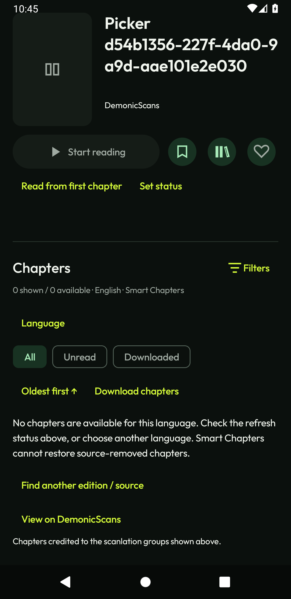
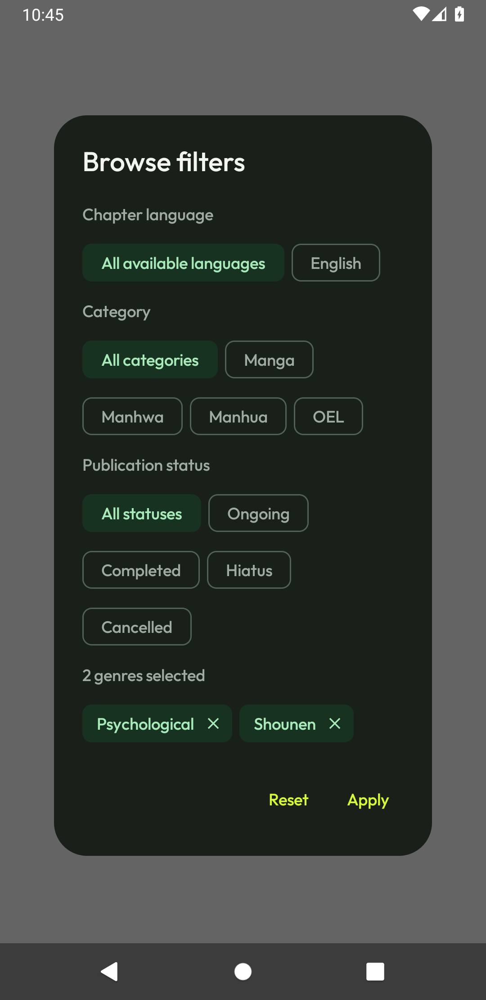

# Title libraries, regular-source genres, Authors responsiveness and HiveToons

Baseline: `4e1815399594120bb579d30031fcd5cf64593778`, following v0.8.16. Unrelated `.gitignore`, October 30 review edits and untracked iOS work are preserved. No package, signing, version, reader-session or download-worker changes.

## Checklist and findings

| Request | Classification / trigger | Implementation |
|---|---|---|
| Libraries beside Save | Missing title-detail action; previously custom assignment required batch selection. | Open the existing transactional library picker directly for the current title. Multiple assignment and library creation remain available. Apply auto-saves; Cancel does not mutate. Preserve the cross-source duplicate warning before opening the picker for an unsaved duplicate. |
| Better regular-source genres | Confirmed: WeebCentral offered only 17 hard-coded tags and discarded native detail genres/category. Its native search page exposes 38 tags. Category/language detail chips also used the generic tag route. | Fetch/cache successful native Weeb/Demonic taxonomies for ten minutes, extract title genres and native Weeb type/status, replace stale genre metadata, route typed chips correctly, and send native Weeb category/status parameters. Add selected genre chips, remove/clear and explicit loading/error/retry controls. Preserve adult-source metadata parsing, facet behavior and the Weeb `adult=False` request. |
| Authors All with 100+ follows | Confirmed from implementation and blocked-request fixture: three creator pages were fetched serially, with nothing published until all three completed. Switching away discarded the loaded catalog. | Keep the existing three-creator round-robin paging, run at most two catalog/enrichment operations concurrently and publish each completed creator page. Keep up to three off-screen catalogs of at most 300 retained titles each. All/individual navigation can restore those results; manual refresh invalidates the cache. Larger catalogs are evicted to bound extra memory. Never request all 100+ creators on first paint. |
| HiveToons cannot connect | Confirmed HTTP trace: `/series` returned `301 Location: http://hivetoons.org/series/`, then redirected back to HTTPS. Android disallows that cleartext hop. | Request Hive's canonical HTTPS trailing-slash document paths directly, retaining query parameters and stable stored source IDs. Use the actual request URL as the HTML base. No cleartext, TLS, DNS, certificate or verification relaxation. |

## Regression coverage and evidence

- JVM: 225 total, 217 passed, eight optional tests skipped, zero failures/errors, with `KOMORI_GENRE_CAPTURE=/tmp` enabled. Captures remain outside the repository.
- Native captured pages: Weeb taxonomy 38 tags; sample details seven genres and Manga category. Hive catalog/genre/details parse; all 28 sample releases and 40 distinct chapter-1 image URLs parse. No image bytes fetched.
- Synthetic 120-creator test: a fast creator publishes while another stays blocked; at most two provider calls active; first batch calls at most three creators; continued fair paging reaches all 120 exactly once. This proves scheduling/first-result behavior, not physical-phone latency or a 120-source live benchmark.
- Debug/test APK and minified release compile passed. Lint: zero errors, 50 warnings, unchanged from baseline.
- API 30 opt-in real Hive test through the app's networking client and Android cleartext policy: catalog 1, genres 3, chapters 28, page manifest 32; zero image bytes. Locked chapters are not bypassed.
- Final affected API 30 run: **11/11 passed**, zero skipped/failures. Covers multi-library save/cancel/unassignment, duplicate confirmation/cancel, 48 dp touch bounds, selected genre remove/clear/retry, 120-creator incremental/cache/refresh behavior, Authors filters/navigation, source facets/drag and the opt-in live Hive request.
- Ten Python release/scan checks passed. Cloud checks are recorded below when complete.

## UI evidence

These are API 30 fixture screens using the app palette/type system. They contain synthetic titles/empty chapter data and three representative native genres; they are not live-source reading screenshots.

An initial new UI test measured the 40 dp painted Material icon-button bounds instead of its 48 dp expanded touch bounds. The assertion was corrected to check the actual touch width/height; the production control was not shrunk or enlarged to satisfy a drawing-bounds test. The title picker tests retain assignment, cancellation and duplicate safeguards. The Authors filter UI test now verifies typed input and waits for the applied filter state, with screenshot/semantics/state capture on failure; no timeout was increased and no assertion was removed.

## Remaining acceptance

The API 30 network result is emulator acceptance from this network, not the user's Android 14 phone/network or an OEM battery check. Full live reading/download sessions, physical low-memory measurements and all source-specific taxonomy changes remain external acceptance. Missing metadata is not invented, nor are unsupported filters advertised. The user confirmed the phone displays “Connection interrupted/reset,” consistent with the generic transport wrapper for the blocked redirect; phone/network acceptance remains pending. This pass does not create or publish a new version.
