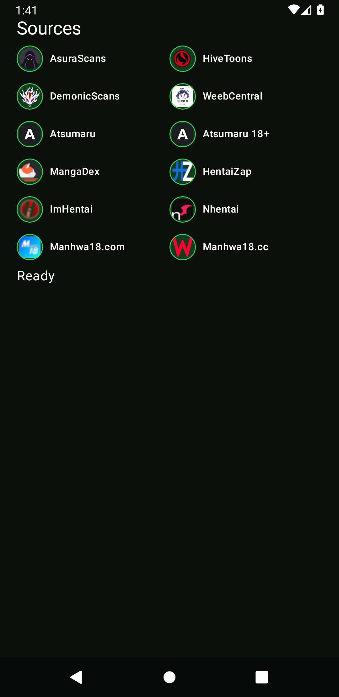

# 0.8.16 — source artwork and Atsumaru catalogs

Baseline: `2ac3337` (main, following the signed v0.8.15 release). Existing iOS work and October 30 review notes were left untouched.

## Implementation

- Bundle actual source website artwork, with a green circular frame in Discover, Settings, Authors source filters and cover source badges. Original artwork colors remain recognizable. No new dependency or runtime favicon service. Decorative icons retain the parent action's accessible name and selection state. See `docs/images/source-icons/provenance.json` for URLs and hashes.
- Add regular Atsumaru after WeebCentral in the default order. Fresh installations enable regular Atsumaru; existing enablement choices and explicitly arranged full ordering survive upgrades.
- Add a distinct Atsumaru 18+ source, initially disabled, using the existing shared affirmative age confirmation. Normal and adult local IDs remain isolated. Public catalog requests enforce their adult flag and Comic medium; novels are excluded.
- Use native public indexed search and genre/category/status filters with popularity, newest-added, rating and title ranking. Fetch complete chapter releases and page manifests rather than the truncated details preview. Preserve alternate groups and absolute delivery URLs, resolve relative media through the site's published CDN, and use its WebP alternative for Android versions without AVIF decoding.
- Fix confirmed creator integration gap: Asura's existing adapter and title metadata supported authors, but ReaderViewModel's whitelist rejected its catalog. Permit Asura and both Atsumaru catalogs and map source ranking explicitly.
- Keep updater, signing identity, package identity, reader navigation and download coordination unchanged.

## Evidence and local validation

Public site HTML and JavaScript confirmed the native endpoints and CDN. Anonymous public API responses were obtained with ordinary browser headers; no verification or TLS bypass was used. Captures stayed outside the repository.

- Search fixture captured from `/collections/manga/documents/search`: 189 matches for the probe query, 30 records on the first page.
- Public adult catalog response: 6,252 records at observation time, with `isAdult=true`. No adult page images fetched.
- One regular title: truncated details preview versus 152 complete alternate chapter releases; chapter endpoint returned 65 ordered page records.
- Adult live metadata probe: details ownership/adult flag validated; 212 complete releases and seven page-manifest records in one sample. Zero page images fetched.
- Published WebP page URL: HTTP HEAD 200 and `image/webp`; no page image committed.
- JVM: 219 total, 212 passed, seven optional tests skipped, zero failures/errors. Public API capture parser check enabled and passed. Fixtures cover catalog separation, query escaping, paging, filters, alternates, page ordering, ownership validation, URL preservation, defaults, ordering and consent.
- Debug, instrumented-test APK and minified release compilation: passed.
- Android lint: zero errors, 50 warnings (same count as preceding local baseline).
- Python release/scan scripts: ten tests passed.
- Final local API 30 affected UI/integration run: six tests passed, zero failures. Includes source consent persistence, bundled artwork decoding, cover semantics/long press, source drag/navigation and Asura/both Atsumaru creator-provider integration. Additional icon-only capture run: one test passed; preview visually inspected.
- PR #12 head `ec793412ab680f776b67a9b5a7c229169f6014ce`: cloud Android checks passed (219 JVM total, 211 passed, eight optional tests skipped). Cloud excludes the external captures used in local validation.
- [PR device matrix](https://github.com/joy-arz/komori-reader/actions/runs/41889496858): API 26/30/34/36 all passed. API 36 reported 103 instrumented tests, zero failures/errors/skips. Startup cleanup and deterministic WorkManager process-recovery probes passed, including emulator screen-off/another-app transfers and battery-exempt Doze continuation.
- [Repeated API 36 selection checks](https://github.com/joy-arz/komori-reader/actions/runs/41889496851): passed.
- PR #12 merged as `58b60bdd32c61845e89d541553365f863f412c11`; `v0.8.16` points to that exact revision. [Merged-commit Android checks](https://github.com/joy-arz/komori-reader/actions/runs/41891476148) passed. [Merged-commit device matrix](https://github.com/joy-arz/komori-reader/actions/runs/41891476078) passed API 26/30/34/36 after one unchanged API 36 rerun. The final API 36 run reported 103 tests with zero failures/errors/skips; startup/process/download recovery probes also passed.
- First merged-commit API 36 attempt: 102/103 tests passed. `AuthorsFilterActionTest.kt:47` observed the primary Authors filter as unselected immediately after Apply. No assertion, timeout or application behavior was changed; the same code passed the PR matrix and the unchanged rerun. Failure logs/XML remain in the first-attempt CI artifact. Root cause is unconfirmed and follow-up state capture is tracked in TODO; do not call this a proven production defect or a resolved race.
- [Signed release and automatic scan job](https://github.com/joy-arz/komori-reader/actions/runs/41891521163), attempt 2: passed. First publication attempt correctly blocked on the device failure. Public [v0.8.16](https://github.com/joy-arz/komori-reader/releases/tag/v0.8.16) contains the full generated release notes, verified against the checked-in text.
- Final public APK: version `0.8.16`, code `139`, package `app.komori.reader`, 2,830,512 bytes; SHA256 `69b0bbeae59551aa3f51cf6b8ae01eaba6bb9d259e757385c8aac7a7b6f67c39`. SHA256/size match both published manifests. Original signing certificate SHA256 remains `0f654f439d6059cf8caea9fa1d5403342cc47b1b5a8228bf90e2858ec423d5fd`. The initial candidate and public APK have different whole-file hashes, so they are not claimed byte-identical.

## Icon preview

This is an icon-set instrumentation fixture, not the actual Discover/Settings layout.

## Acceptance boundaries

API response inspection, deterministic fixture parsing, local emulator UI checks and release compilation are separate evidence. No physical low-memory phone, OEM background restrictions, complete live reading/download session or logged-in/premium source entitlement was validated in this change. Source availability and catalog counts can change externally. Locked or unavailable content is not bypassed.

## Additional signed-upgrade probe

The actual signed 0.8.15 → 0.8.16 APK upgrade was exercised on the disposable API 30 emulator. Library visibility, saved page restoration, process-death navigation restoration and offline page 3/3 navigation passed. Package, version, size, digest and original certificate were verified separately.

The older `device_acceptance.py` harness did not finish green unchanged: first it encountered the reused emulator's retained Webtoon setting although its final action requires paged mode. Screenshot/hierarchy showed working Webtoon controls, not a missing reader. After a fresh disposable fixture, all UI stages passed, but its final assertion still expected database schema 6. Current Room/exported schema is 7 (custom-library migration from 0.8.15). Direct inspection verified schema 7, saved/liked `(1, 1)` and exactly one retained progress record for the fixture. These were pre-existing harness assumptions; no reader/database behavior was changed to satisfy them. The standalone harness now derives the expected target version from the checked-in exported schemas. Re-execution on the same signed APK with a fresh disposable fixture passed schema 5→7, saved/liked/progress retention, process-death restoration and offline navigation. This validation-only script correction is separate from the tagged APK code.

The exact published APK was then exercised again with the corrected harness: **PASS**, including schema 5→7, saved/liked/progress retention, process-death restoration and offline page navigation. Final public APK scan: zero malicious, zero suspicious, 68 undetected and seven unsupported engines; see `docs/security/virustotal/0.8.16.json`. README evidence was refreshed automatically.
